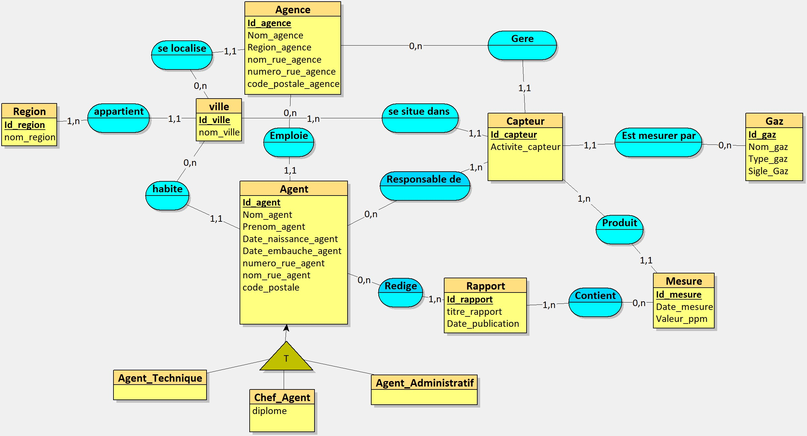

# Clear Data : base de données de suivi de la qualité de l'air

Projet de modélisation et de bases de données réalisé en 1ère année à CESI Dijon (2025).
Cas d'étude fictif : l'équipe **Clear Data** conçoit, pour le ministère de la transition écologique, un prototype de base de données pour suivre la qualité de l'air dans les grandes villes françaises.

## Contexte

Après le dernier rapport du GIEC, la surveillance de la qualité de l'air est devenue un enjeu majeur. Le ministère souhaite centraliser les données environnementales des grandes villes. Le projet consiste à concevoir une base **fiable, exploitable et évolutive**.

## Objectifs

- Stocker les données environnementales et suivre les mesures de pollution (en ppm).
- Gérer les agences, les agents, les capteurs et les rapports d'analyse.
- Structurer les données et garantir leur cohérence.
- Permettre des analyses rapides et fiables.

## Démarche

1. Dictionnaire de données (regroupement des attributs).
2. Modélisation avec la méthode **Merise** : MCD, MLD et MPD, en **3ème forme normale** (MCD réalisé avec Looping).
3. Création de la base **MySQL** (moteur **InnoDB**) : agences, agents (techniques et administratifs), capteurs, gaz, mesures, rapports, villes, régions.
4. Peuplement avec des données fictives de démonstration, choisies pour que les requêtes renvoient des résultats.
5. Écriture de **12 requêtes SQL** demandées par le ministère.
6. Spécifications techniques : deux comptes utilisateurs (un compte administrateur avec tous les droits, un compte utilisateur limité à SELECT, INSERT et UPDATE).

## Modèle conceptuel de données (MCD)



Le MCD comprend les entités **Région**, **Ville**, **Agence**, **Agent**, **Capteur**, **Gaz**, **Mesure** et **Rapport**. L'entité **Agent** est spécialisée (héritage) en **Agent technique**, **Chef d'agent** (avec son diplôme) et **Agent administratif**. Les associations relient notamment les agents aux capteurs dont ils sont responsables, les capteurs aux mesures qu'ils produisent et aux gaz qu'ils mesurent, et les rapports aux mesures qu'ils contiennent.

## Requêtes réalisées

Les 12 requêtes couvrent notamment :

- sélections et filtres (`WHERE`, `BETWEEN`) ;
- jointures multiples et `LEFT JOIN` ;
- agrégations (`COUNT`, `AVG`, `GROUP BY`, `HAVING`) ;
- `DISTINCT` pour éviter les doublons ;
- fonction de fenêtrage `RANK() OVER (PARTITION BY ...)` ;
- calcul de durées avec `TIMESTAMPDIFF` ;
- requête paramétrée avec une variable (`@gaz_recherche`).

Chaque requête est expliquée dans le rapport ci-dessous.

## Exécuter le projet

Prérequis : **MySQL 8 ou plus** (la requête 8 utilise une fonction de fenêtrage).

```sql
CREATE DATABASE livrable2;
USE livrable2;
SOURCE sql/01_creation_tables.sql;
SOURCE sql/02_peuplement.sql;
-- Optionnel : comptes administrateur et utilisateur (remplacer les mots de passe avant)
-- SOURCE sql/03_comptes_utilisateurs.sql;
```

Les 12 requêtes se trouvent dans `sql/requetes/` et s'exécutent une à une. Avec ce jeu de données, la requête 12 ne renvoie aucune ligne (aucune région n'a plus de capteurs que d'agents).

## Contenu du dépôt

| Fichier | Description |
|---|---|
| `sql/01_creation_tables.sql` | Création des tables (clés primaires et étrangères, spécialisation des agents) |
| `sql/02_peuplement.sql` | Données fictives de démonstration |
| `sql/03_comptes_utilisateurs.sql` | Comptes administrateur et utilisateur (mots de passe à remplacer) |
| `sql/requetes/` | Les 12 requêtes SQL |
| `docs/dictionnaire_de_donnees.xlsx` | Dictionnaire de données (attributs, types, commentaires) |
| `docs/mcd.jpg` | Modèle conceptuel de données (image) |
| `docs/mcd_looping.loo` | Fichier source du MCD (à ouvrir avec Looping) |
| `docs/livrable_2_peuplement_et_requetes.pdf` | Rapport : peuplement de la base, 12 requêtes commentées, comptes utilisateurs |
| `docs/presentation_clear_data.pdf` | Présentation du projet |

## Équipe

Projet réalisé en équipe de trois : [Lilian Lafon], Ilyass AIT ALI et [Emma Vives].

**Ma contribution :** réalisation du MCD, de la base de données et des requêtes SQL.

## Outils

MySQL Workbench, Looping, Microsoft Office.
